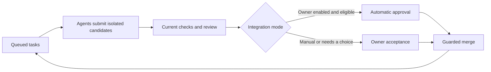

# Projects Git

A Git workspace where coding agents can keep working across tasks and sessions.
Projects holds the queue, isolated candidate branches, checks and review history;
your existing coding host runs the agents. An owner-enabled policy can integrate
eligible changes automatically after current checks and independent review pass.

## Workflow



Agents can continue eligible work while another candidate waits. Hosted
[automatic integration](docs/automatic-merge.md) starts off and requires an owner
policy, current checks and a passing independent review. Alternatives and
exceptions need an owner choice. Manual acceptance and merge remain separate
guarded steps; merging does not deploy.

Changed code, requirements or project bases require fresh checks and review.
Earlier commits, reports and decisions stay available for comparison and recovery.

Browse projects, open their task queues, then move between task briefs and the
separate candidate collections. **Find work** searches all workspace project
names; recent/pinned shortcuts keep the sidebar compact. Lists filter and page
without changing full workflow totals. See [navigation and counts](docs/collection-navigation.md).

## Try it locally

Requires Node.js 24.19+ and npm:

```sh
git clone https://github.com/wornpage/projects-git-challenge.git
cd projects-git-challenge
npm ci
npm run dev:demo
```

Open **http://127.0.0.1:8894** and choose **Explore a completed project**. The
read-only example uses the real workbench with clearly labeled fictional records.
It needs no account, model key or Docker runtime.

To connect your own committed Git repository:

```sh
npm run dev
```

Open the printed address and choose **New project**. Git is required; independent
checks on ordinary code also require Docker and a selected immutable image.
See [setup and troubleshooting](docs/setup.md).

## Connect your coding agent

Choose **Project settings → Connect agent → Copy agent instructions** and give
those instructions to your coding conversation. Its host runs the agent.

```sh
node scripts/repository-work.mjs --help
```

Use [the local agent workflow](docs/agent-workflow.md),
[a private hosted connection file](docs/hosted-agent-client.md), or
[the MCP setup](docs/mcp.md). Hosted builders can claim, check out, start, push
and submit their assignments. The server enforces identity and permissions;
builders cannot accept or merge candidates.

## Built on Cloudflare

| Component | Responsibility |
| --- | --- |
| Workers + Access | Authenticated API and separate owner, builder and reviewer permissions |
| Durable Objects + SQLite | Workspace state, reservations, decisions and recovery |
| Artifacts | Project repositories, isolated agent forks and Git commits |
| Containers | Independent command checks on submitted code |
| Queues | Artifacts push notifications and reconciliation with repository refs |
| D1 | Searchable retained project history |

The local adapter uses owned Git copies and Docker. Both adapters share workflow
rules and the browser workbench. Hosted operation requires your own Cloudflare
resources and identity configuration. Public and preview routes are disabled in
the supplied configuration; configure Access before exposing a workspace.

## Guides and operator references

The hosted model has one authenticated owner with restricted builder and reviewer
identities. Team administration is planned. Four execution slots and two
verification attempts are shared across the workspace.

| Guide | Purpose |
| --- | --- |
| [Source map](docs/source-map.md) | Find implementation modules |
| [App model](docs/app-model.md) | Understand tasks, retained work and counters |
| [Automatic integration](docs/automatic-merge.md) | Set policy and handle exceptions |
| [Independent review](docs/independent-review.md) | Review and decision boundaries |
| [Authenticated ownership](docs/authenticated-workspace.md) | Owner, builder and reviewer permissions |
| [Cloudflare guide](docs/cloudflare.md) | Hosted architecture and API |
| [Operator setup](docs/qualification-setup.md) | Configure your own hosted workspace |

## Check the source

With PowerShell 7, Git and Docker's Linux engine running:

```sh
pwsh -NoProfile -File scripts/ci.ps1
```

This installs locked dependencies, audits them, runs tests and type checks, and
builds the Workers without deploying them. See [source CI](docs/private-ci.md).
Local results are written to ignored `qa/ci/`; they are not part of this source
repository. GitHub Actions is disabled on this challenge repository.

## Source and license

[MIT](LICENSE). This is an independent Cloudflare competition prototype in the
Projects family. Third-party assets retain their included license notices.
See [source provenance](docs/source-map.md#source-provenance) for the repository's
origin.
