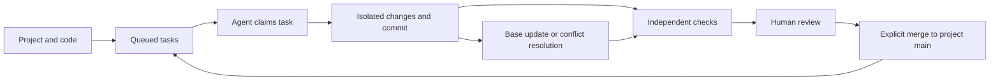

# How Projects Git works

Updated October 11, 2026 (America/New_York). This describes the local project workflow.
Live Cloudflare qualification remains separate.

## One project, a queue of work

A project owns code and its task queue. A task describes one outcome, owner and
requirements. Agents claim tasks and produce candidates. Independent checks,
acceptance and merge are distinct transitions. Multiple candidates can be
alternatives for one task; different tasks share project main.

Connect code once or use the checkout starter. Its first task has two scripted
alternatives. Follow-up tasks stay in the same project and use the ordinary queue.
Preparing a checkout never launches an external model. [CLI and limits](connected-repositories.md).

## Conversation and delegated work

The person steers an existing coding conversation, backed by this workspace for
delegated work. **Copy agent instructions** in a local project's connection panel
provides the actual project ID, workspace origin, CLI entrypoint and workflow
guide. The agent uses that CLI to discover work, queue agreed tasks, revise
requirements, report progress and return links to review.

The conversation's host controls agent execution. Queueing work does not start a
model, and disabling admission does not interrupt an already-running agent. The
workspace retains requirements, isolated candidates, checks and decisions; it
does not duplicate the chat transcript. Acceptance and merge remain distinct UI
actions. See the [agent workflow](agent-workflow.md) for the complete local loop.

The CLI connects to the local loopback controller with `--url`, or to the hosted
app with a [private Access connection file](hosted-agent-client.md). Hosted mode
uses the existing task and run APIs with restricted builder permissions. The
[MCP v2 stdio server](mcp.md) exposes those hosted builder operations to coding
hosts through the same client and receipts. The coding host owns its conversation
and model execution.

## Views and next actions

| View | Responsibility |
| --- | --- |
| Projects | Browse the project directory; use Find work for project names outside the loaded page. |
| Task queue | Filter, sort and page all tasks in the selected project with complete totals. |
| Task details | Read the task brief, current requirements, revisions, prerequisites and next action; export its full handoff. |
| Candidates | Browse the task's results and progress; prepare alternatives and obtain agent handoffs. |
| Candidate | Inspect changes and checks, update an outdated base, compare alternatives, record a decision and merge separately. |
| Project history | Browse retained candidates and activity across the selected project. |
| Candidate record | Read one candidate's reports and decisions; task and whole-workspace exports remain explicit. |

Choose a recent/pinned project in the sidebar, browse **Projects**, or use
**Find work** to search all workspace project names. Its views share one project
header with the current main and **New task**. **Project settings** contains **Connect agent** and
the admission switch; paused assignments remain visible in the header. Counts and
activity follow that project. Task requirements and candidate details stay inside
its views. Opening a project lands on its task queue without silently selecting
a task or candidate; the URL restores explicit detail selections after reload.

Unassigned tasks bind current main when claimed. Assigned tasks retain their base.
An explicit base update creates a replacement candidate and supersedes earlier
candidates without deleting them. Conflicts receive a resolution checkout. Check
definitions can be reused, but must run again. Every replacement needs a new review.

Turning **Accept new agent work** off blocks checkouts and starts. Queueing, existing
submissions, checks, review and merge continue. Running agents are not terminated.
Claims survive restart; partial checkout preparation is reconciled before new work.

Creation/claim retries reuse their request ID. Invalid imports unlock editing; an
unknown outcome can be checked before releasing the request. Task/review drafts
and expanded details survive reload in the same browser tab. Submitted records
live on the server. Credentials never enter browser draft storage. View, task and
candidate are in the URL.

## Steering work as requirements change

The queue contains compact title/status rows with full task counts. Selecting one
opens its separate task brief and preserves the selection in the URL. The sidebar
and return link lead back to the queue. Merged work stays in the same collection. The task brief
shows its purpose, requirements, state and one primary next action. Requirement
history pages earlier revisions; a compact result count links to Candidates.
**Revise direction** uses the existing guarded revision form. Earlier commits
and reports remain recorded. **New task** opens the project-bound composer.

Current passing checks do not prove that all written requirements are satisfied.
Stale reports identify the revision they checked and lead to current check setup.
Shared files identify changes to compare; they do not assert a merge conflict.
Active assignments made before a revision are called out so the person can steer
the coding conversation or resolve an obsolete assignment. Review, acceptance and
merge continue through their existing controls. Blockers and shared files expand
with candidate cards. **Project activity** and **Workspace summary** hold
supporting records, with every retained candidate still in the displayed
denominator. [Collection navigation](collection-navigation.md) describes visible
page limits, complete counts and the selected-project data boundary.

## Definitions and counters

| Field | Definition |
| --- | --- |
| Queued tasks | Unassigned tasks, including failed checkout preparation before execution. |
| Active tasks | Tasks with assigned or running candidates. |
| Need a decision | Unmerged tasks awaiting review or accepted but awaiting merge; can overlap active tasks. |
| Merged tasks | Explicitly merged tasks / all retained tasks. |
| Running agents | Running candidates / four shared execution slots; waiting assignments are listed separately. |
| Latest reported checks | Sum of passed / total checks in each retained candidate's latest `run.evidence` report. Includes unverified or stale latest reports and superseded candidates; excludes `evidenceHistory`. |
| Historical check reports | Separate original passed/total counts for each `run.evidenceHistory` entry. Commit, revision, timestamp and provenance stay with that report; historical counts are not added to the latest-report KPI. |
| Current acceptance | Accepted or merged candidates / all retained candidates. Revoked decisions remain in history. |
| Independent verification | Execution at the exact commit/current requirements. A verified report can contain failures. |
| Owner/reviewer | Attribution; local names are not independently authenticated users. |

A latest **3/3** result can coexist with an earlier **0/2** report. The KPI
describes the three checks in the latest report; the two earlier failed checks
remain historical results. **Earlier check reports** in Evidence exposes each
original result separately. Download the task handoff from Evidence to inspect
`payload.runs[].evidence` and `payload.runs[].evidenceHistory` separately.
The workspace JSON export retains the same separate fields. Server-tagged merge
attempts have their own Review/Evidence panel and timestamps; an untagged old
report does not establish merge provenance.

Acceptance requires all checks to pass, current project base and ownership, settled
related work and explicitly compared overlapping heads. Merge reruns the checks
and verifies the accepted exact head. Reviewers assess criteria not covered by tests.

## Runtime scope

Local projects use bounded Git copies and Docker verification for external code;
the starter uses a trusted checkout harness. Source working trees and deployments
are separate from project merges. The Cloudflare controller implements authenticated
Artifacts project queues, fork claims, admission controls and bounded model work
through the same panels. Its code input is an Artifacts repository name; the local
backend takes a filesystem path. Ordinary hosted tasks use explicit command checks
in fresh containers; base updates and resolution assignments retain prior evidence
and require a new review. The bounded model starter keeps its explicit checkout
profile. See [hosted checks and limits](hosted-repository-checks.md). Local Worker and
provider-fixture proof does not establish live hosted access, 100/1,000-agent scale
or multi-user authorization. See [Cloudflare workflow](cloudflare.md).

Source owners: core/workflow owns transitions; core/project-work owns shared queue
selection and policy; each runtime controller owns durable admission and requests; local/repository-runner owns
connected Git work; public/app renders snapshots and dispatches actions.
