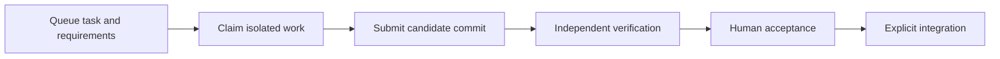

# Read the source

Start with the request path below. The browser uses native ES modules and the
existing HTTP protocol. The UI modules do not depend on SvelteKit or generated
server endpoints.

## Browser ownership

| File | Owns |
| --- | --- |
| [`public/app.js`](../public/app.js) | Startup, workspace polling, page routing and operation orchestration |
| [`public/browser-session.js`](../public/browser-session.js) | Workspace-scoped tab storage for review drafts, disclosures, request IDs and composer snapshots |
| [`public/api-client.js`](../public/api-client.js) | The single browser HTTP boundary: request IDs, headers, authentication failures, response parsing and redaction |
| [`public/workspace-connection.js`](../public/workspace-connection.js) | Workspace reads, polling, refresh coordination, connection status and session guards |
| [`public/workbench-actions.js`](../public/workbench-actions.js) | Action progress, guarded snapshot adoption and stable operation request IDs |
| [`public/ui/navigation.js`](../public/ui/navigation.js) | Find work, displayed result selection, keyboard navigation and destination selection |
| [`public/ui/dialogs.js`](../public/ui/dialogs.js) | Native-dialog dismissal guards and focus restoration |
| [`public/ui/continuation-dialog.js`](../public/ui/continuation-dialog.js) | Selected candidate preview, freshness checks and guarded copying |
| [`public/ui/task-composer.js`](../public/ui/task-composer.js) | Compact draft selection, one mounted editor, all-draft validation and prerequisite choices |
| [`public/ui/task-creation.js`](../public/ui/task-creation.js) | Project-scoped task drafts, source selection, submission and explicit request recovery |
| [`public/ui/requirements-form.js`](../public/ui/requirements-form.js) | Unsaved requirement proposals, comparisons and revision-guarded saving |
| [`public/ui/review-form.js`](../public/ui/review-form.js) | Review drafts, prerequisite display, acceptance/rejection and separate merge controls |
| [`public/ui/dom.js`](../public/ui/dom.js) | DOM construction, formatting, disabled-control help and focus helpers |
| [`public/ui/views/queue.js`](../public/ui/views/queue.js) | Focused task brief, visible requirements and result actions |
| [`public/ui/views/work.js`](../public/ui/views/work.js) | Agent progress and retained candidate cards |
| [`public/ui/views/review.js`](../public/ui/views/review.js) | Verification setup, stale-evidence guidance, base updates and review layout |
| [`public/ui/views/evidence.js`](../public/ui/views/evidence.js) | Project records, retained-work search and evidence exports |
| [`public/ui/workbench-parts.js`](../public/ui/workbench-parts.js) | Shared project task rail, phone selector, task brief, prerequisites, candidate navigation, diffs and check reports |
| [`public/ui/report-list.js`](../public/ui/report-list.js) | Flat retained-report selection and exact report identity, counts and provenance |
| [`public/review-handoff.js`](../public/review-handoff.js) | Reviewer display labels, request-status text and assignment-specific human links; grants no authority |
| [`public/ui/retained-search.js`](../public/ui/retained-search.js) | Scoped asynchronous history queries and explicit index rebuild requests |
| [`public/workbench-state.js`](../public/workbench-state.js) | Pure task/candidate outcomes, project counts and navigation entries shared with the CLI |

The entrypoint constructs the UI owners once. Each receives current state through
`getContext` and explicit operations such as `api`, `refresh` and `switchView`.
Local dialog state stays with its owner. The entrypoint owns the native task
composer and secondary inspector drawer; selecting a draft destination does not
navigate the background page. Task creation owns its draft stack and
pending request; browser session storage restores saved state for the current
workspace. The entrypoint owns the fetched workspace. There is one implementation of each moved path;
the old inline versions were removed.

`views[view]()` is the one page-rendering dispatch. The page factories compose
shared panels and receive explicit callbacks for operations. Search response
guards read the current workspace after each await so navigating or starting a
newer search cannot let an older response replace the current results.

Task creation saves the request ID and submitted body before sending. A failed
connection or unconfirmed result retains that request; only an explicit retry
resends it. The saved-request action either returns the original tasks or confirms
that no tasks were saved before unlocking editing. Replies from an earlier
workspace session cannot change a later session, including a switch away and back.
Control tokens and one-time checkout credentials are kept outside tab storage.

A forced workspace refresh waits for a read started after any in-flight read.
The superseded response is not rendered, so it cannot clear the task selected by
the completed action. Ordinary polling shares the current read. Older snapshot
versions cannot replace newer state; reconnecting invalidates earlier replies.
Action completions and request-ID cleanup also check the workspace session.
Mutation replies containing a project projection also check the originating
view, task, candidate and page path. After navigation, the current page remains
loaded and gets a fresh read. A failed follow-up read cannot turn a confirmed
mutation into an uncertain write.

## Hosted agent entry points

`scripts/repository-work.mjs` supplies CLI arguments; `scripts/agent-mcp.mjs`
serves MCP over stdio, with strict tool schemas in `src/local/hosted-mcp.mjs`.
Both call `HostedAgentClient.execute` in `src/local/hosted-agent-client.mjs`.
That module owns authenticated requests, assignment checks, Git operations,
private receipts, redaction and post-write readback. The Worker remains the
authority for permissions, capacity and durable workspace state. See [MCP setup](mcp.md).

## Follow one task to merge



| Step | Where to follow it | Boundary to notice |
| --- | --- | --- |
| Queue | `createWorkbenchTask` in `public/ui/task-creation.js`; `queueProjectTasks` in `src/core/project-work.mjs` | One request ID retains a task batch; prerequisite validation is atomic |
| Claim | `scripts/repository-work.mjs`; claim handlers in `src/local/server.mjs` and `src/cloudflare/controller.ts`; `assignRun` in `src/core/workflow.mjs` | Admission, capacity and integrated prerequisites gate isolated code access |
| Commit | Submit handlers in those controllers; `completeRun` in `src/core/workflow.mjs` | Code is retained at a specific Git commit; submission is not verification |
| Verify | `verificationSetup` / `revisionEvidence` in `public/ui/views/review.js`; `src/local/repository-checks.mjs` or hosted check handling; `verifyRun` in `src/core/workflow.mjs` | Evidence binds to the candidate head and requirement revision |
| Accept | `submitReview` in `public/ui/review-form.js`; `reviewRun` in `src/core/workflow.mjs` | The backend checks current evidence, ownership, requirements and compared heads again |
| Merge | `submitMerge` in the same UI module; provider merge handling in the controllers; `mergeRun` in `src/core/workflow.mjs` | Acceptance and integration are separate guarded operations |

The browser and CLI enter through the same local controller operations. Hosted
requests enter through `src/cloudflare/index.ts` and the workspace controller.
Provider-neutral workflow rules remain in `src/core/`; the browser's state labels
do not authorize writes.

## Run the focused checks

```sh
node --test tests/dialog-lifecycle.test.mjs tests/ui-module-contracts.test.mjs tests/page-views.test.mjs tests/search-ui-lifecycle.test.mjs tests/action-feedback.test.mjs tests/workspace-connection.test.mjs tests/browser-session.test.mjs tests/task-creation.test.mjs tests/browser-assets.test.mjs tests/workbench-state.test.mjs tests/workflow.test.mjs
```

The extracted dialog/form tests import the actual modules with a minimal test
DOM. They cover delayed responses, stable selection, stale drafts, and separate
acceptance/merge requests. The browser asset test follows every local module
import through the real server. Real browser checks remain necessary for layout,
focus, native validation and responsive behavior. These tests do not run models
or deploy anything.
